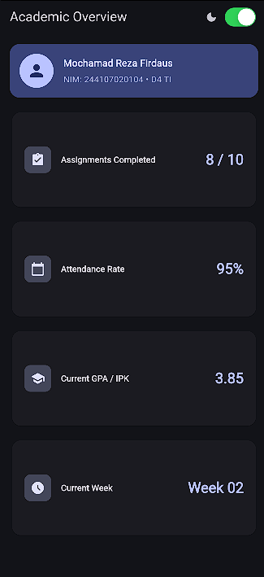
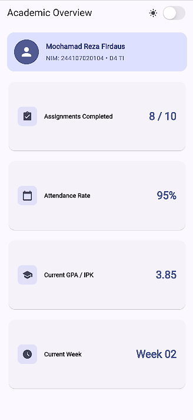
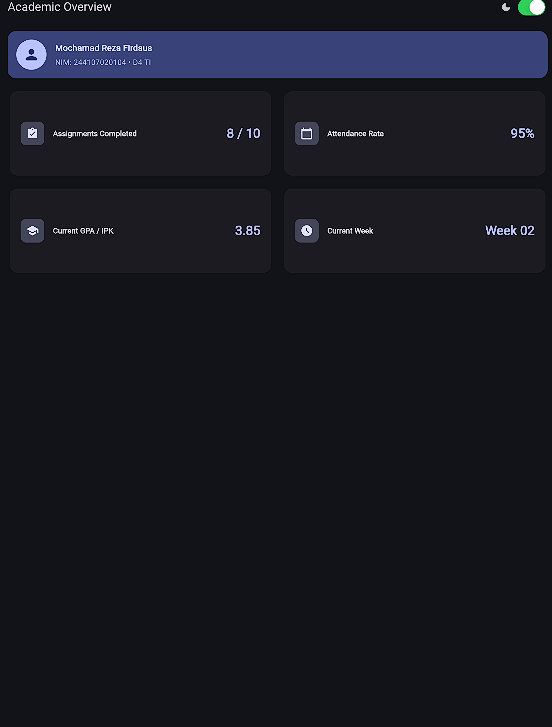

# Week 02 - Declarative UI & Responsive Design

- **Nama:** Mochamad Reza Firdaus
- **NIM:** 244107020104
- **Program Studi:** D4 Teknik Informatika

---

## Hasil Praktikum

### 1. Tampilan Mobile / Layar Sempit (Dark Mode)

### 2. Tampilan Mobile / Layar Sempit (Light Mode)

### 3. Tampilan Tablet / iPad (Responsive 2 Kolom)

---

## AI Prompt Challenge & Exploration

### 1. Prompt Desain: Perbandingan GridView vs LayoutBuilder + Column
* **Prompt:** *"Bandingkan dua tata letak dashboard akademik untuk Flutter: versi GridView dan versi LayoutBuilder + Column. Jelaskan trade-off responsif dan aksesibilitasnya."*
* **Keputusan yang Dipilih:** Menggunakan `LayoutBuilder` yang dikombinasikan dengan `GridView.count` di mana jumlah kolom (`crossAxisCount`) ditentukan secara dinamis berdasarkan lebar layar (`constraints.maxWidth >= 700 ? 2 : 1`).
* **Alasan Teknis:** Kombinasi ini menghasilkan kode yang jauh lebih ringkas dan mudah dipelihara (*clean code*) tanpa perlu menduplikasi struktur baris dan kolom secara manual. Selain itu, rasio kartu terjaga secara konsisten melalui properti `childAspectRatio` dan tetap ramah terhadap *screen reader* dengan pembungkus widget `Semantics`.

### 2. Prompt Penguatan Konsep: Overflow pada Expanded di dalam Row
* **Prompt:** *"Jelaskan kapan penggunaan Expanded justru menyebabkan overflow atau error di dalam Row, beri contoh kondisi yang gagal dan perbaikannya."*
* **Temuan:** Widget `Expanded` akan menghasilkan error *unbounded constraints* apabila ditempatkan di dalam `Row` yang berada di dalam wadah gulir horizontal (seperti `SingleChildScrollView(scrollDirection: Axis.horizontal)` atau `ListView` horizontal). Hal ini terjadi karena `Expanded` berusaha menghabiskan sisa ruang yang tersedia, sedangkan ruang horizontal di dalam *scroll view* bernilai tak terhingga (*infinite*).
* **Solusi:** Pastikan widget induk (`Row`) memiliki batas lebar yang jelas (*bounded width*), atau ganti `Expanded` dengan widget berukuran tetap/`Flexible` dengan ukuran intrinsik saat berada di dalam *scrollable horizontal*.

### 3. Verification Prompt
* **Audit Teknis:** 
  * Tampilan telah diuji pada dimensi lebar di bawah 600px (otomatis beradaptasi menjadi 1 kolom tanpa memicu *render overflow*).
  * Pada layar lebar/iPad (≥ 700px), tata letak otomatis berubah menjadi 2 kolom secara proporsional.
  * Seluruh kartu informasi telah diekstrak menjadi widget terpisah yang *reusable* (`InfoCard`) dan dilengkapi dengan label `Semantics` untuk mendukung aksesibilitas *screen reader*.
  * Menggunakan API Flutter stabil (Material 3 `colorSchemeSeed` dan `CupertinoSwitch`).

---

## Jawaban Refleksi

1. **Perbedaan cara berpikir imperative vs declarative saat membangun UI:**  
   Pada paradigma *imperative*, pengembang harus memanipulasi komponen antarmuka secara langsung tahap demi tahap saat terjadi perubahan data (misalnya memanggil method untuk mengubah warna atau teks elemen tertentu). Sebaliknya, pada paradigma *declarative* di Flutter, antarmuka merupakan fungsi langsung dari *state* (`UI = f(state)`). Pengembang cukup mendeklarasikan seperti apa tampilan UI untuk kondisi *state* tertentu (seperti variabel `_isDark`), dan *framework* Flutter akan secara otomatis membangun ulang (*rebuild*) bagian *widget tree* yang relevan ketika *state* berubah.

2. **Kapan Expanded membantu dan kapan menghasilkan error?**  
   `Expanded` sangat membantu ketika kita ingin membagi sisa ruang kosong yang tersedia secara proporsional di dalam `Row` atau `Column` (misalnya membuat teks judul kartu mengambil ruang tengah yang tersisa di antara ikon di kiri dan nilai di kanan agar tidak saling bertabrakan). Namun, `Expanded` akan menghasilkan error apabila diletakkan di dalam widget induk yang memiliki batas ukuran tak terhingga (*unbounded constraints*), seperti di dalam `ListView` atau `SingleChildScrollView` yang searah dengan sumbu utamanya.

3. **Pengaruh breakpoint dan theme terhadap pengalaman pengguna (UX):**  
   Penggunaan *breakpoint* memastikan tata letak aplikasi tampil optimal di berbagai ukuran perangkat—tidak terlalu sempit dan berhimpitan di layar ponsel, serta tidak menyisakan ruang kosong berlebihan atau kartu yang terlalu melar di layar tablet/iPad. Sementara itu, dukungan tema (*Light Mode* dan *Dark Mode*) meningkatkan kenyamanan visual pengguna di berbagai kondisi pencahayaan ruangan, menghemat daya baterai pada layar OLED, serta menjaga konsistensi hierarki warna dan keterbacaan teks.
