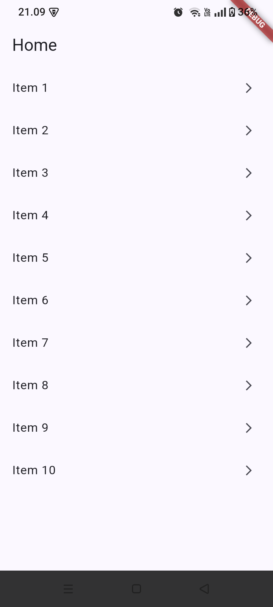
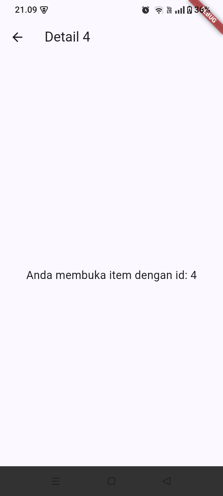
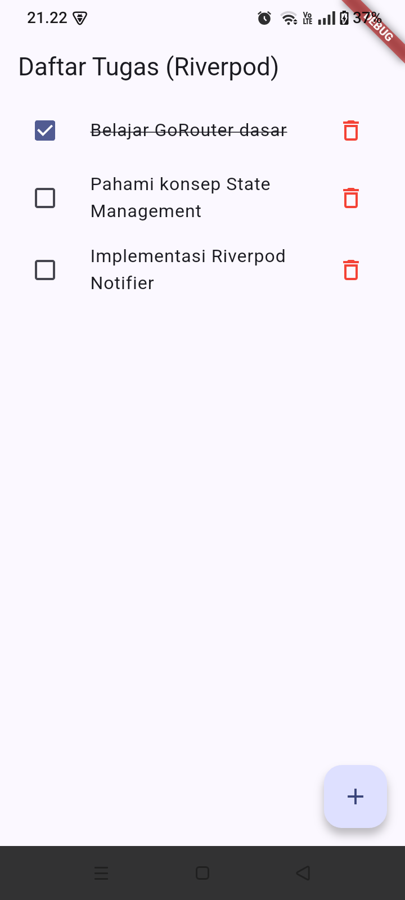
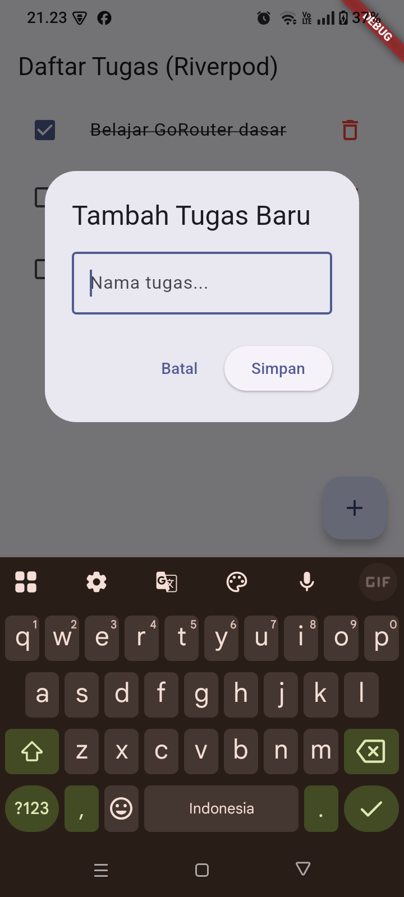
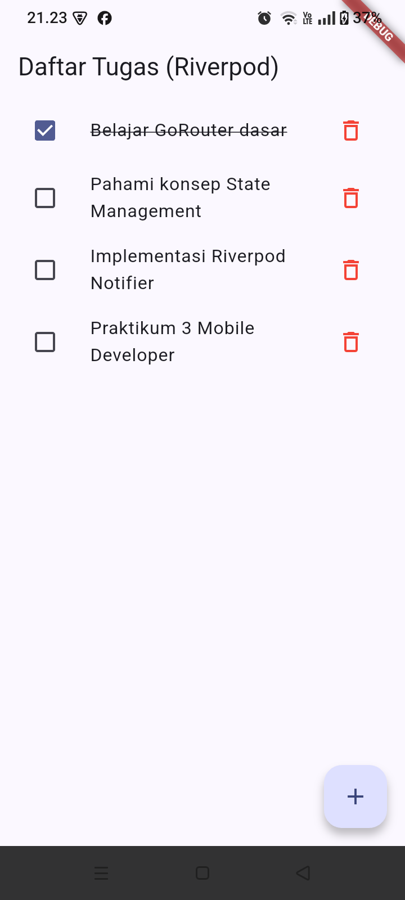
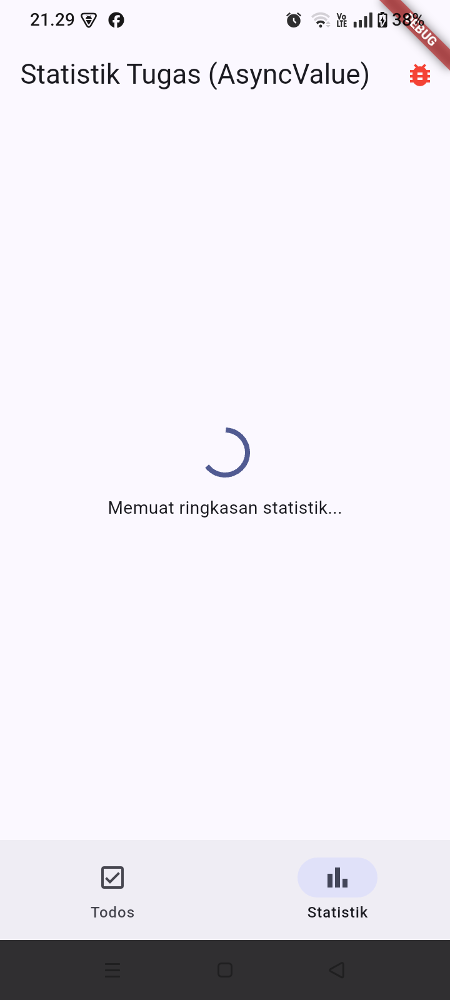
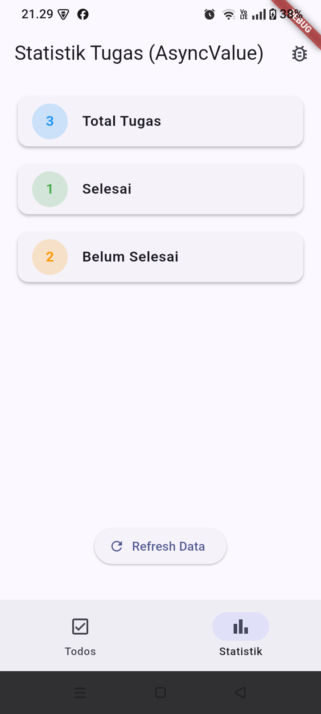
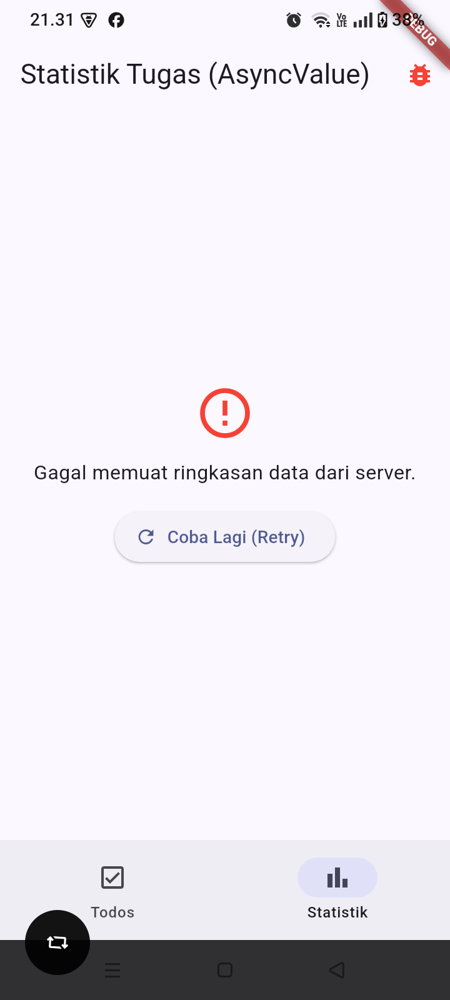

# Laporan Praktikum Week 3: Navigasi dan State Management

## Identitas Mahasiswa
* **Nama**: Mochamad Reza Firdaus
* **NIM**: 244107020104
* **Mata Kuliah**: Pemrograman Mobile

---

## Praktikum 1: Navigasi Deklaratif dengan GoRouter
Mengimplementasikan routing bertingkat dan *path parameter* dinamis untuk menampilkan detail item sesuai ID yang diklik.

| Tampilan Utama (Home) | Halaman Detail 1 | Halaman Detail 4 |
| :---: | :---: | :---: |
|  |  |  |

---

## Praktikum 2: State Management ToDo List (Riverpod Notifier)
Mengelola status tugas reaktif (tambah tugas, toggle status selesai, dan hapus tugas) menggunakan arsitektur modern `Notifier` dan `NotifierProvider`.

| Daftar Tugas Awal | Dialog Input Tugas | Daftar Setelah Tugas Ditambahkan |
| :---: | :---: | :---: |
|  |  |  |

---

## Praktikum 3: ShellRoute & AsyncValue (Halaman Statistik)
Menggabungkan Bottom Navigation Bar (`ShellRoute`) dengan penanganan siklus data asinkron `AsyncValue` (Loading, Success, Error Handling dengan Retry).

| State Loading | State Data Berhasil | State Error & Retry |
| :---: | :---: | :---: |
|  |  |  |
