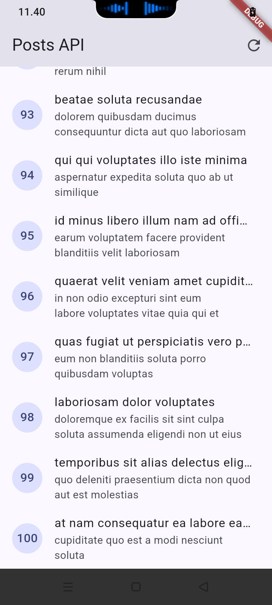
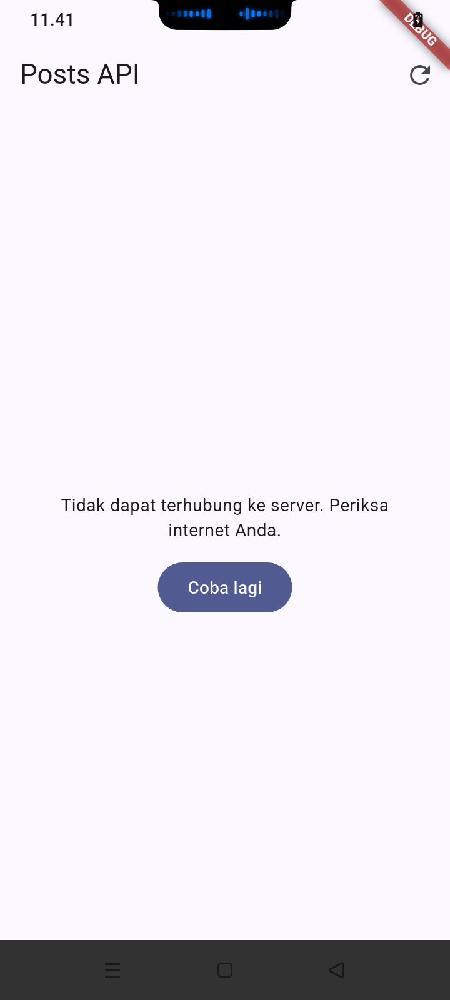
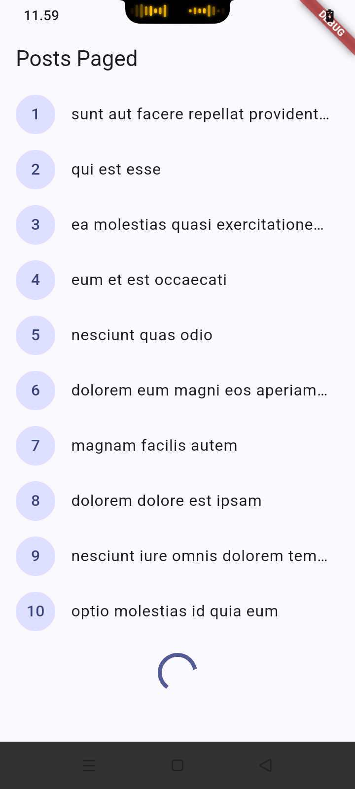
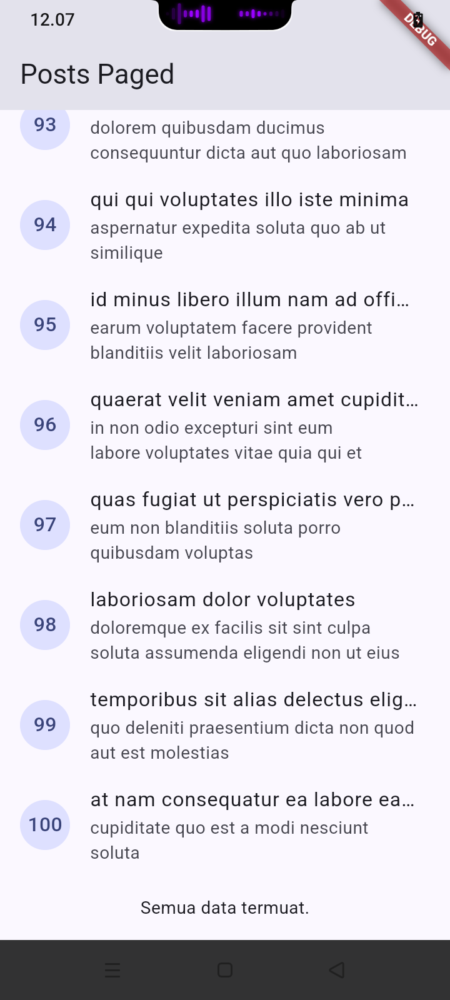
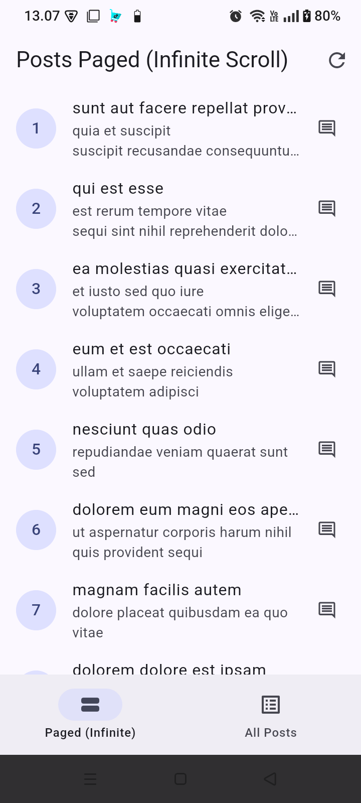
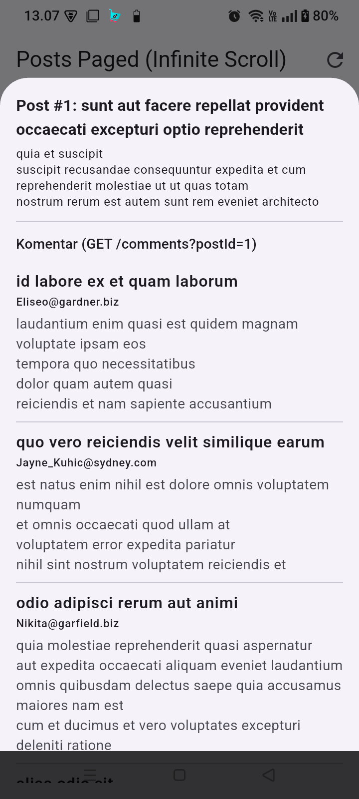

# Laporan Praktikum & Mini Project Minggu 4: Networking & REST API

**Nama:** Mochamad Reza Firdaus  
**NIM:** 244107020104  
**Program Studi:** D4 Teknik Informatika - Politeknik Negeri Malang  

---

## Tujuan Proyek
Proyek ini bertujuan untuk mengimplementasikan komunikasi HTTP dan konsumsi data REST API (`JSONPlaceholder`) pada aplikasi Flutter menggunakan arsitektur **Repository Pattern** serta manajemen state **Riverpod** (`AsyncNotifier`, `Notifier`, dan `AsyncValue`). Melalui pemisahan lapisan data dan antarmuka pengguna (UI), aplikasi dirancang agar aman terhadap nilai `null` (*null-safe serialization*), mampu menangani berbagai skenario kesalahan jaringan secara ramah pengguna, mendukung pemuatan bertahap (*infinite scroll pagination*), serta dapat diuji secara terisolasi menggunakan *mock/fake repository* tanpa koneksi internet sungguhan.

---

## Fitur Utama
1. **Konfigurasi Dio Terpusat (`api_client.dart`):** Mengatur `baseUrl` (`https://jsonplaceholder.typicode.com`), `connectTimeout` (10 detik), `receiveTimeout` (10 detik), header JSON, dan `LogInterceptor` di satu tempat terpusat.
2. **Serialisasi Model Aman-Null (`Post` & `Comment`):** Memetakan respons `Map<String, dynamic>` menjadi objek Dart menggunakan *defensive casting* (`as num?`, `as String?`) dan nilai *fallback* (`?? 0`, `?? ''`) untuk mencegah *crash* saat *field* hilang atau bernilai `null`.
3. **Repository Pattern (`PostRepository` & `CommentRepository`):** Menjadi satu-satunya pintu akses ke REST API sehingga widget UI tidak pernah memanggil `Dio` secara langsung.
4. **Penanganan 4 State UI (`AsyncValue`):** Menampilkan tampilan berbeda untuk kondisi *Loading* (`CircularProgressIndicator`), *Error* (pesan ramah pengguna + tombol **Coba lagi**), *Empty* (`Belum ada data dari server.`), dan *Success* (`ListView` dengan `RefreshIndicator`).
5. **Infinite Scroll Pagination (`_page` & `_limit=10`):** Memuat data secara bertahap (10 item per halaman) menggunakan `ScrollController` (memicu pemuatan 200px sebelum batas bawah) yang dilengkapi *guard* pencegah *request* ganda (`if (state.isLoadingMore || !state.hasMore) return;`).
6. **Integrasi Komentar Post (Mini Project & AI Challenge):** Menampilkan daftar komentar dari endpoint `GET /comments?postId={id}` melalui *DraggableScrollableSheet* (*Bottom Sheet*) saat item post diketuk, dilengkapi navigasi bawah (`NavigationBar`) untuk berpindah antara tampilan *Paged (Infinite)* dan *All Posts*.
7. **Unit Testing & Mock Repository:** Menguji parsing `fromJson` dengan *field* hilang/*edge case*, pemetaan pesan `DioException`, serta pengujian state `postListProvider` menggunakan `FakePostRepository`.

---

## Hasil yang Dicapai

### A. Praktikum 1: Mengambil Data dari REST API (`GET /posts`)
Mengambil 100 daftar *posts* dari endpoint `/posts` melalui `PostRepository` dan menampilkannya pada `PostListPage` menggunakan `postListProvider`.

| Daftar Post Berhasil Dimuat (`GET /posts`) |
| :---: |
|  |

---

### B. Praktikum 2: Error Handling & Skenario Retry
Memetakan `DioException` (seperti kondisi internet mati / mode pesawat, *timeout*, maupun status error server 404/500) menjadi pesan ramah pengguna melalui `friendlyErrorMessage()` disertai tombol **Coba lagi** untuk memuat ulang data:

| Penanganan Error Koneksi & Tombol Coba Lagi |
| :---: |
|  |
| *Tidak dapat terhubung ke server. Periksa internet Anda.* |

---

### C. Praktikum 3: Pagination Dasar & Infinite Scroll
Menerapkan pemuatan bertahap (`GET /posts?_page=N&_limit=10`) pada `PagedPostPage`:
1. Halaman 1 (ID 1–10) dimuat terlebih dahulu, dan saat digulir mendekati batas bawah, indikator `CircularProgressIndicator` tampil di bagian bawah tanpa menghapus data yang sudah ada.
2. Halaman berikutnya digabungkan secara berurutan hingga mencapai item ke-100 dan menampilkan keterangan akhir daftar (`Semua data termuat.`).

| Halaman 1 (ID 1–10) & Indikator Loading | Akhir Daftar (`Semua data termuat.`) |
| :---: | :---: |
|  |  |

---

### D. Pengembangan Mini Project: Navigasi & Integrasi Komentar (`GET /comments?postId={id}`)
Mengembangkan proyek codelab dengan menambahkan `NavigationBar` untuk berpindah antara tab *Paged (Infinite)* dan *All Posts*, serta menampilkan *Bottom Sheet* berisi daftar komentar saat salah satu item *post* diketuk.

| Navigasi Utama (`Paged` & `All Posts`) | Bottom Sheet Komentar (`GET /comments?postId=1`) |
| :---: | :---: |
|  |  |

---

## AI Verification Checklist

Berikut adalah catatan hasil verifikasi terhadap kode yang dihasilkan AI pada pembuatan *repository layer* `GET /comments?postId={id}` (dokumentasi lengkap tersedia di [`docs/catatan_teknis_ai.md`](docs/catatan_teknis_ai.md)):

- [x] **1. Apakah UI memanggil Dio secara langsung (dilarang) atau lewat repository?**
  - **Temuan:** Lewat repository (`CommentRepository`). Lapisan UI sama sekali tidak memanggil `Dio` secara langsung, melainkan hanya memantau state dari `commentsProvider` (`AsyncNotifierProvider`).
- [x] **2. Apakah `fromJson` aman null, atau masih memakai cast langsung yang bisa crash?**
  - **Temuan:** Aman null. `Comment.fromJson` telah menggunakan *nullable cast* (`as num?` dan `as String?`) disertai nilai *fallback* (`?? 0` dan `?? ''`).
- [x] **3. Apakah semua tipe `DioExceptionType` (timeout, connectionError, badResponse) dipetakan ke pesan pengguna?**
  - **Temuan:** Seluruh tipe `DioExceptionType` (`connectionTimeout`, `sendTimeout`, `receiveTimeout`, `connectionError`, `badResponse` untuk status 404 & 500, `cancel`, `badCertificate`, `unknown`, serta `default`) telah dipetakan ke pesan bahasa Indonesia yang ramah pengguna pada fungsi `commentFriendlyErrorMessage()`.
- [x] **4. Apakah `baseUrl`/timeout terpusat di satu client, bukan tersebar di tiap method?**
  - **Temuan:** Pada output awal AI, instansiasi `Dio` dan timeout dibuat terpisah di dalam `CommentRepository`. Kode telah diperbaiki agar menerima injeksi `dioProvider` yang merujuk pada `createDio()` di `lib/data/api_client.dart`, sehingga `baseUrl` dan timeout 10 detik terpusat di satu client.
- [x] **5. Apakah test AI benar-benar menguji kasus field hilang, atau hanya happy path? Tambahkan minimal 1 edge case sendiri.**
  - **Temuan:** Unit test pada `test/comment_test.dart` menguji skenario *field* yang hilang (*missing fields*), ditambah 1 *edge case* mandiri yaitu kondisi ketika field berisi nilai `null` eksplisit dan nilai `postId` bertipe `double` (`2.0`).
- [x] **6. Jalankan `flutter analyze` dan `flutter test`, apakah hasil AI lolos tanpa warning?**
  - **Hasil `flutter analyze`:** Lolos tanpa warning maupun error (`No issues found!`).
  - **Hasil `flutter test`:** Seluruh 6 pengujian pada `test/post_test.dart` dan `test/comment_test.dart` lolos (`All tests passed!`).

---

## Checklist Verifikasi Mandiri

- [x] UI tidak memanggil `Dio` langsung, semua akses data lewat repository + provider.
- [x] Empat state tampil benar: *loading*, *error* (+ tombol retry), *empty*, dan *success*.
- [x] Pagination: data bertambah saat scroll, tidak ada request ganda (*guard* aktif), dan terdapat indikator akhir data.
- [x] `flutter analyze` tanpa *issue* dan semua test (`flutter test`) lulus.
- [x] Hasil AI diverifikasi dan didokumentasikan pada folder `docs/catatan_teknis_ai.md`.

---

## Refleksi

### 1. Mengapa UI dilarang memanggil Dio langsung? Apa yang rusak jika aturan ini dilanggar?
Memanggil `Dio` langsung di dalam widget UI melanggar prinsip *Separation of Concerns* karena mencampurkan logika tampilan dengan detail teknis jaringan (URL endpoint, parameter query, header, serialisasi JSON, dan penanganan kode status HTTP). Jika aturan ini dilanggar:
- **Pemeliharaan Kode Sulit (*Low Maintainability*):** Ketika ada perubahan struktur JSON atau pergantian URL di sisi server, pengembang harus mengedit banyak file widget satu per satu.
- **Sulit Diuji (*Low Testability*):** Kita tidak dapat melakukan *unit test* atau *widget test* secara terisolasi menggunakan *fake/mock repository* (seperti `FakePostRepository` pada `post_test.dart`), karena setiap kali widget dibangun akan memicu panggilan HTTP sungguhan ke internet.

### 2. Kapan pagination client-side cukup, dan kapan harus mengandalkan pagination server (`_page`/`_limit`)?
- **Pagination Client-Side** cukup digunakan apabila jumlah total data di server relatif sedikit (misalnya di bawah 100–200 baris teks sederhana), ukuran payload JSON sangat kecil, data jarang berubah, atau seluruh data memang dibutuhkan di memori perangkat untuk fitur pencarian/penyortiran lokal secara instan.
- **Pagination Server-Side (`_page`/`_limit`)** wajib digunakan ketika kumpulan data berukuran besar (ribuan hingga jutaan item) atau terus bertambah secara dinamis. Mengambil seluruh data sekaligus tanpa pagination server akan memperlambat waktu muat awal (*response time* tinggi), memboroskan kuota internet pengguna, membebani database server, dan berisiko menyebabkan *Out of Memory (OOM)* atau *frame drop* pada perangkat mobile.

### 3. Bagaimana exception repository berubah menjadi `AsyncError` tanpa `try/catch` di setiap widget? Kapan `try/catch` eksplisit tetap dibutuhkan?
- Di dalam metode `build()` milik `AsyncNotifier` (maupun saat menggunakan `AsyncValue.guard`), Riverpod secara otomatis membungkus pemanggilan `Future` dengan mekanisme penangkap *exception* internal. Ketika `PostRepository` atau `CommentRepository` melempar `DioException`, exception tersebut dibiarkan naik (*bubble up*) ke notifier, lalu Riverpod mengubah state menjadi `AsyncError(error, stackTrace)`. Widget UI cukup merender state tersebut secara deklaratif melalui `.when(loading: ..., error: ..., data: ...)` tanpa blok `try/catch`.
- **`try/catch` eksplisit tetap dibutuhkan** ketika:
  1. Kita mengelola state kustom menggunakan `Notifier<T>` biasa (bukan `AsyncNotifier`), contohnya pada `PagedPostsNotifier.loadNextPage()` di mana kita wajib menangkap error secara manual agar daftar item halaman sebelumnya (`currentItems`) tetap dipertahankan di layar dan tidak hilang saat request halaman baru gagal.
  2. Saat mengeksekusi aksi mutasi pengguna (seperti menekan tombol Simpan/Hapus) yang hanya membutuhkan umpan balik sementara seperti `SnackBar` atau dialog peringatan tanpa mengganti seluruh halaman utama menjadi tampilan error.

### 4. Bagian mana dari hasil AI yang Anda perbaiki, dan mengapa?
1. **Sentralisasi HTTP Client (`Dio`):** Output awal AI membuat instance `Dio(BaseOptions(...))` baru di dalam class `CommentRepository`. Bagian ini diperbaiki dengan menyuntikkan instance `Dio` melalui constructor `CommentRepository(this._dio)` yang bersumber dari `dioProvider` (`createDio()` di `api_client.dart`). Tujuannya agar `baseUrl`, timeout 10 detik, dan interceptor tetap terpusat di satu tempat (*Single Source of Truth*).
2. **Keamanan Parsing List & Kepatuhan Linter Dart:** Mengganti `(response.data as List).map(...)` menjadi `data.whereType<Map<String, dynamic>>().map(Comment.fromJson).toList()` untuk mencegah *runtime type error* jika respons bernilai `null`. Selain itu, menambahkan klausa `default:` pada `switch (error.type)` di fungsi pemetaan `DioExceptionType` untuk mengatasi error linter `non_exhaustive_switch_statement` terkait varian `DioExceptionType.transformTimeout`.
3. **Penambahan Edge Case pada Unit Test:** Menambahkan skenario pengujian baru pada `test/comment_test.dart` untuk memverifikasi ketahanan `Comment.fromJson` saat menerima nilai `null` eksplisit pada seluruh properti serta konversi tipe angka `double` ke `int`.
