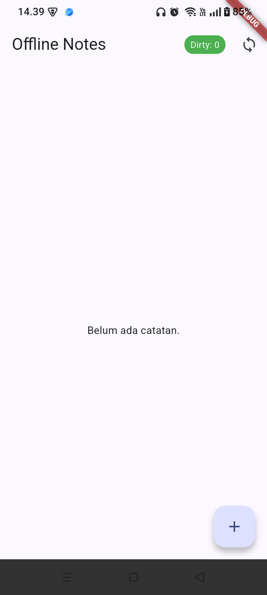
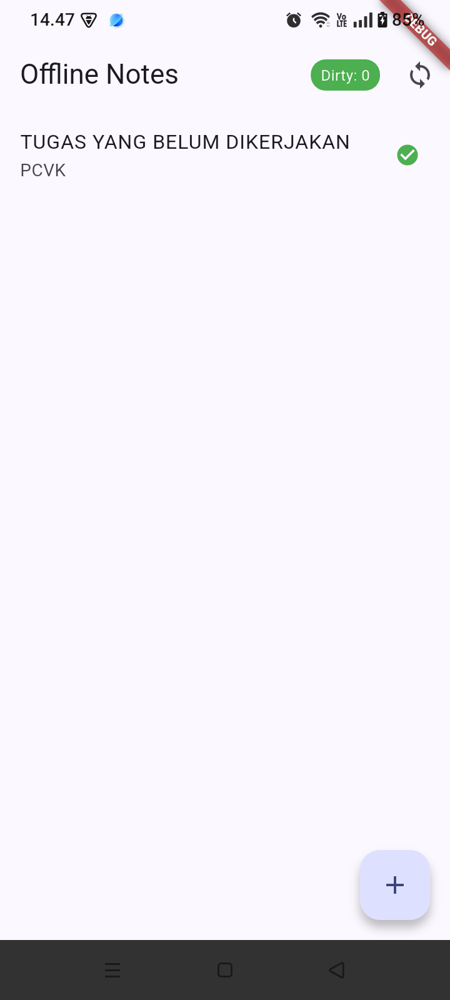

# Week 5: Local Storage & Offline-First Notes Application

Aplikasi catatan berbasis Flutter yang menerapkan arsitektur *offline-first*, penyimpanan lokal hibrida (SharedPreferences + SQLite), antrean sinkronisasi berbasis *dirty flag*, dan manajemen status reaktif menggunakan Riverpod.

---

## 1. Fitur Utama

- **Preferensi Lokal**: Pengaturan tema (gelap/terang) dan pencatatan waktu terakhir aplikasi dibuka berbasis *key-value* menggunakan SharedPreferences.
- **CRUD Catatan Persisten**: Manajemen data catatan tersimpan di SQLite lokal (`sqflite`), otomatis diurutkan berdasarkan `updated_at DESC`.
- **Offline-First & Dirty Tracking**: Operasi baca/tulis berfungsi penuh tanpa jaringan internet. Entri lokal yang belum dikirim ke server ditandai otomatis dengan `dirty = 1`.
- **Antrean Sinkronisasi**: Memicu sinkronisasi manual untuk mengunggah catatan tertunda dan mereset status `dirty` menjadi `0`.
- **Unit Testing**: Pengujian model serialisasi dan abstraksi provider menggunakan *fake repository* tanpa ketergantungan database fisik.

---

## 2. Stack Teknologi

- **Framework**: Flutter (Dart SDK 3.x)
- **State Management**: Flutter Riverpod (`Provider`, `FutureProvider`, `AsyncNotifierProvider`)
- **Key-Value Store**: `shared_preferences`
- **Relational Database**: `sqflite` & `path`
- **Testing**: `flutter_test`

---

## 3. Bukti Implementasi & Mode Pesawat

| Kondisi Awal (Kosong) | Sebelum Sinkronisasi (Offline/Dirty) | Sesudah Sinkronisasi (Synced) | Tampilan Final + Settings |
| :---: | :---: | :---: | :---: |
|  |  |  |  |

---

## 4. Aturan Resolusi Konflik (Conflict Resolution Rule)

Aplikasi menetapkan aturan **Last-Write-Wins (LWW)** berdasarkan stempel waktu kolom `updated_at`:
- Setiap perubahan pada entri lokal mencatat waktu `DateTime.now().toIso8601String()`.
- Saat proses sinkronisasi dua arah terjadi, data dengan nilai `updated_at` paling mutakhir yang akan dipertahankan di database pusat maupun cache lokal.
- Strategi ini mencegah data tertimpa secara implisit saat perangkat kembali online setelah sesi perubahan offline yang panjang.

---

## 5. Jawaban Refleksi (Modul Bagian 8)

### 1. Mengapa daftar catatan tidak boleh disimpan di SharedPreferences? Apa yang rusak jika aturan ini dilanggar?

`SharedPreferences` dirancang untuk menyimpan data primitif berukuran kecil menggunakan mekanisme *key-value*. Pada implementasi tertentu, seluruh berkas XML atau plist dimuat ke memori saat inisialisasi aplikasi. Jika koleksi data besar, seperti ribuan catatan dalam satu string JSON, dipaksakan disimpan di sana, beberapa masalah dapat muncul:

- **UI jank:** Proses serialisasi dan deserialisasi JSON dalam jumlah besar dapat membebani *main thread* dan menyebabkan antarmuka membeku.
- **Tidak mendukung pengelolaan data terstruktur secara optimal:** `SharedPreferences` tidak menyediakan mekanisme pengindeksan (*indexing*), pencarian parsial, atau pemfilteran data seperti database relasional.
- **Tidak efisien untuk pembaruan data:** Perubahan pada satu catatan dapat mengharuskan penulisan ulang keseluruhan string JSON ke disk.
- **Keterbatasan atomic update:** Tidak tersedia mekanisme transaksi per baris seperti pada database SQLite.

Oleh karena itu, penyimpanan seperti SQLite melalui `sqflite` lebih sesuai untuk koleksi catatan yang membutuhkan operasi CRUD, pencarian, dan pengelolaan data terstruktur.

### 2. Kapan cache-first cukup, dan kapan Anda membutuhkan strategi lain, misalnya network-first untuk data harga real-time?

- **Cache-first** cocok untuk data referensi yang frekuensi perubahannya rendah atau data personal yang perlu langsung ditampilkan ketika aplikasi dibuka. Contohnya adalah daftar posting, catatan pribadi, dan profil pengguna. Strategi ini meningkatkan responsivitas antarmuka dan memungkinkan pengguna mengakses data yang tersimpan secara lokal ketika tidak ada koneksi internet.
- **Network-first** cocok untuk data yang membutuhkan informasi terbaru dan akurasi tinggi, seperti harga saham atau kripto, ketersediaan tiket konser, serta stok barang e-commerce. Strategi ini mengutamakan pengambilan data dari server, kemudian dapat menggunakan cache sebagai fallback jika jaringan gagal, sesuai kebutuhan aplikasi.

Pemilihan strategi harus mempertimbangkan kebutuhan konsistensi data, toleransi terhadap data usang (*stale data*), ketersediaan jaringan, dan pengalaman pengguna. Untuk transaksi keuangan atau pembelian barang, validasi akhir tetap perlu dilakukan oleh server.

### 3. Bagaimana dirty flag berubah menjadi antrean sync tanpa memblokir UI? Kapan antrean terpisah (tabel outbox) menjadi perlu?

*Dirty flag* menandai data lokal yang belum berhasil disinkronkan dengan server. Repository dapat mengambil data tersebut melalui query seperti `WHERE dirty = 1`, lalu memproses pengiriman secara asinkron menggunakan `Future` agar UI tetap responsif.

Alur sinkronisasi secara umum:

1. Pengguna membuat atau mengubah catatan secara lokal.
2. Repository menyimpan perubahan ke database dan menandai catatan sebagai `dirty`.
3. Proses sinkronisasi mengambil catatan yang belum tersinkronisasi.
4. Repository mengirim perubahan ke server secara asinkron.
5. Jika server mengonfirmasi keberhasilan, status `dirty` diperbarui menjadi `false`. Jika gagal, data tetap tersimpan untuk dicoba kembali.

**Tabel outbox terpisah** menjadi relevan ketika aplikasi harus melacak setiap operasi sinkronisasi secara individual, terutama untuk kebutuhan berikut:

- Menjaga urutan operasi mutasi yang saling bergantung.
- Menggunakan *idempotency keys* untuk mencegah operasi ganda ketika permintaan dikirim ulang.
- Menerapkan mekanisme *retry* dengan *exponential backoff*.
- Menyimpan penanda penghapusan (*tombstone*) agar penghapusan data offline tetap tersinkronisasi dengan server.
- Melacak status, jumlah percobaan, dan riwayat operasi yang belum berhasil dikirim.

Untuk aplikasi catatan sederhana, *dirty flag* dapat mencukupi. Namun, ketika sinkronisasi membutuhkan pelacakan operasi dan jaminan urutan yang lebih kuat, tabel outbox memberikan kontrol yang lebih baik.

### 4. Bagian mana dari rekomendasi AI yang Anda tolak, dan mengapa?

Rekomendasi penggunaan **Drift** ditolak untuk tahap implementasi aplikasi saat ini. Meskipun Drift menawarkan *type-safety*, query yang lebih ekspresif, dan dukungan stream reaktif, penambahan dependensi *code generation*, seperti `build_runner` dan `drift_dev`, menambah kompleksitas konfigurasi serta proses pengembangan.

Untuk aplikasi catatan dengan skema database yang relatif sederhana, **`sqflite` dinilai sudah memadai**. Ketika dipadukan dengan *repository pattern* dan Riverpod, pendekatan ini memungkinkan pemisahan tanggung jawab antara akses data, logika aplikasi, dan antarmuka, sekaligus mendukung pengujian melalui repository palsu (*fake repository*).

Keputusan ini merupakan pertimbangan proporsionalitas antara kebutuhan teknis dan kompleksitas implementasi, bukan berarti Drift memiliki performa yang lebih buruk. Jika kebutuhan aplikasi berkembang menjadi query relasional yang lebih kompleks, migrasi skema yang lebih terstruktur, atau pemanfaatan stream reaktif secara intensif, Drift dapat dievaluasi kembali.
