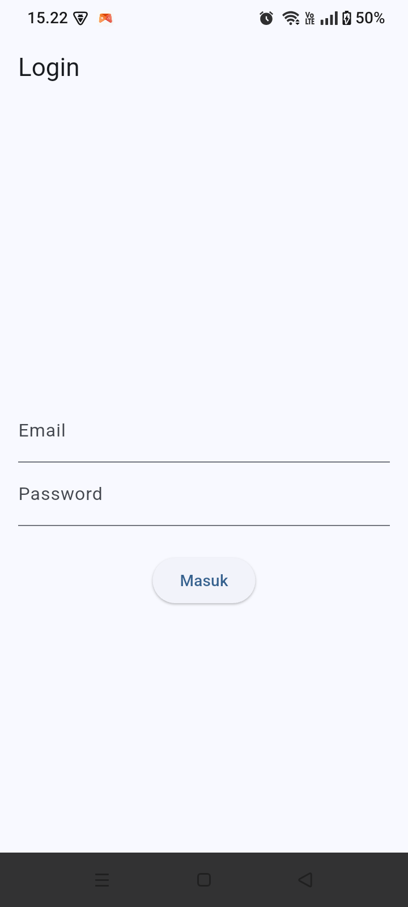
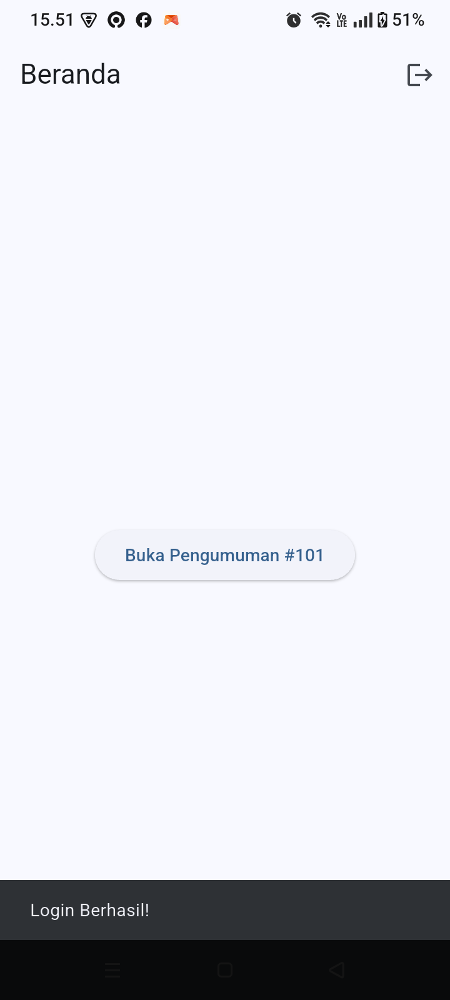
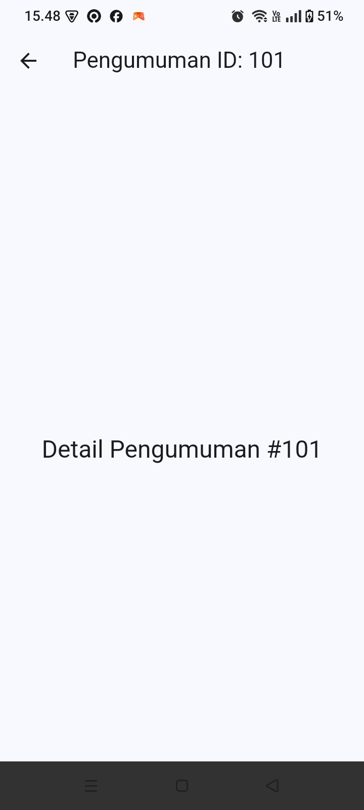
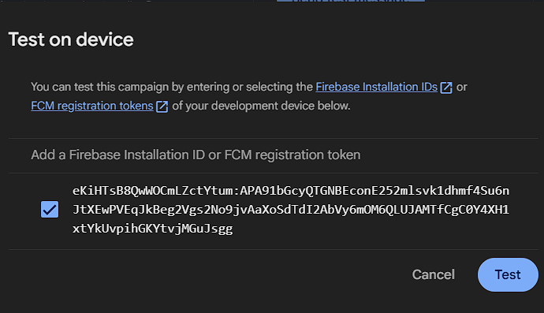
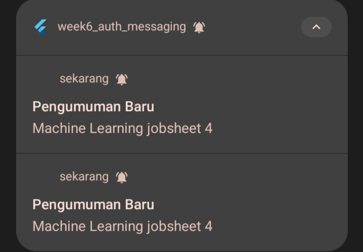
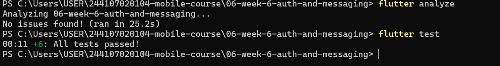

# Week 6 — Authentication, Security & Firebase Cloud Messaging (Campus Notification App)

Repositori ini berisi implementasi **Campus Notification App** untuk praktikum Minggu ke-6 yang berfokus pada autentikasi aman menggunakan `flutter_secure_storage`, proteksi rute (*route guard*) dengan `GoRouter` dan `Riverpod`, integrasi *push notification* **Firebase Cloud Messaging (FCM)** pada tiga *app state* (*Foreground, Background, Terminated*), serta *deep linking* ke halaman detail pengumuman.

---

## 1. Tujuan Praktikum
1. Mengimplementasikan alur autentikasi dengan *redirect guard* pada `GoRouter` sehingga pengguna yang belum login selalu diarahkan ke `/login`.
2. Menyimpan token sesi secara aman menggunakan `flutter_secure_storage` serta menangani kedaluwarsa sesi (401 *auto-refresh* satu kali dan paksa *logout* apabila *refresh token* tidak valid/habis).
3. Mengintegrasikan Firebase Cloud Messaging (FCM) meliputi permintaan izin runtime (`requestPermission`), pengambilan token (`getToken`), sinkronisasi pembaruan token (`onTokenRefresh` ke endpoint `POST /devices`), dan langganan topik `pengumuman-kampus`.
4. Menangani notifikasi gabungan (*notification* + *data payload*) agar klik notifikasi mengarahkan pengguna ke rute `/pengumuman/:id` dari kondisi *foreground*, *background*, maupun *terminated*.
5. Mengekstrak logika parsing rute (`routeFromMessage`) dan pemetaan pesan error jaringan (`ApiErrors`) agar dapat diuji secara terisolasi melalui *unit test* tanpa ketergantungan langsung pada Firebase.

---

## 2. Fitur Utama & Stack Teknologi

### Fitur Utama
* **Authentication & Route Guard:** Proteksi navigasi otomatis berbasis state autentikasi Riverpod dan `GoRouter`.
* **Secure Token Storage & Session Handling:** Penyimpanan `access_token` dan `refresh_token` terenkripsi menggunakan `FlutterSecureStorage`, disertai pemetaan error HTTP (`401`, *timeout*, *offline*) menjadi pesan ramah pengguna.
* **FCM Push Notification & Topic Subscription:** Mendukung penerimaan pengumuman kampus melalui topik `pengumuman-kampus` maupun pengiriman langsung via *registration token* dengan konfigurasi `high_importance_channel` pada `AndroidManifest.xml`.
* **Deep Linking 3 App States:** Navigasi otomatis menuju halaman `/pengumuman/:id` (contoh: `/pengumuman/101`) saat pengguna mengetuk notifikasi.
* **Unit Testing Tanpa Firebase Sungguhan:** Pengujian logika ekstraksi rute, status autentikasi provider, pembersihan sesi saat refresh gagal, dan pemetaan error jaringan.

### Stack Teknologi
* **Framework:** Flutter & Dart
* **State Management:** `flutter_riverpod`
* **Navigation & Deep Linking:** `go_router`
* **Push Notification:** `firebase_core`, `firebase_messaging`
* **Keamanan Penyimpanan Lokal:** `flutter_secure_storage`
* **Testing:** `flutter_test`

---

## 3. Struktur Direktori

```text
06-week-6-auth-and-messaging/
├── android/
│   └── app/src/main/AndroidManifest.xml
├── docs/
│   └── ai_challenge.md          # Prompt, Output Awal AI, Checklist, & Perbaikan Manual
├── lib/
│   ├── auth/                    # State autentikasi, TokenStore, & LoginPage
│   ├── data/
│   │   └── api_errors.dart      # Pemetaan error (401, timeout, offline) ke pesan UI
│   ├── messaging/
│   │   └── push_service.dart    # Integrasi FCM, topic subscription, & background handler
│   ├── routes.dart              # Konstanta rute & pure function routeFromMessage()
│   └── main.dart                # Inisialisasi aplikasi, GoRouter guard, & halaman UI
├── screenshots/
│   ├── 01-login-page.png
│   ├── 02-home-success.png
│   ├── 03-detail-pengumuman.png
│   ├── 04-fcm-console-test.png
│   ├── 05-fcm-notification-received.png
│   └── 06-analyze-and-test-passed.png
├── test/
│   ├── auth_push_test.dart      # Unit test parsing rute, sesi/refresh, & API errors
│   └── widget_test.dart         # Smoke test aplikasi
└── README.md
```

---

## 4. Cara Menjalankan Aplikasi

1. **Instal seluruh dependensi proyek:**
   ```bash
   flutter pub get
   ```
2. **Jalankan analisis kode statik (*linter*) dan *unit test*:**
   ```bash
   flutter analyze
   flutter test
   ```
3. **Jalankan aplikasi pada perangkat fisik Android:**
   ```bash
   flutter run
   ```

---

## 5. Tabel Pengujian Tiga App State (Perangkat: Realme RMX3933)

| App State | Skenario Pengujian | Payload Data (`route`) | Perilaku Banner / Log | Hasil Saat Diklik / Navigasi Tujuan | Status |
| :--- | :--- | :--- | :--- | :--- | :---: |
| **Foreground** *(Aplikasi sedang terbuka)* | Aplikasi aktif di halaman Beranda (`/`), kirim pesan uji dari Firebase Console. | `/pengumuman/101` | Ditangkap oleh listener `FirebaseMessaging.onMessage` dan tercatat di log konsol. | Navigasi menuju `/pengumuman/101` berhasil membuka halaman **Detail Pengumuman #101**. | **Lulus** |
| **Background** *(Aplikasi diminimalkan)* | Tekan tombol Home di perangkat, kirim *Test Message* dari Firebase Console. | `/pengumuman/101` | Sistem Android menampilkan *heads-up banner* **"Pengumuman Baru - Machine Learning jobsheet 4"** di *system tray*. | Ketukan pada banner memicu `onMessageOpenedApp` dan mengarahkan aplikasi ke `/pengumuman/101`. | **Lulus** |
| **Terminated** *(Aplikasi ditutup total)* | Tutup paksa aplikasi dari *Recent Apps*, kirim *Test Message* dari Firebase Console. | `/pengumuman/101` | Banner notifikasi muncul di bilah status perangkat melalui `high_importance_channel`. | Ketukan pada banner menjalankan *cold start*, memeriksa sesi login di `TokenStore`, dan mengeksekusi `getInitialMessage()`. | **Lulus** |

---

## 6. Dokumentasi Hasil Pengujian (Screenshots)

### A. Alur Autentikasi & Deep Linking Aplikasi
| 1. Halaman Login (`/login`) | 2. Halaman Beranda (`/`) | 3. Tujuan Deep Link (`/pengumuman/101`) |
| :---: | :---: | :---: |
|  |  |  |
| *Tampilan autentikasi awal saat pengguna belum memiliki sesi login.* | *Redirect otomatis ke Beranda setelah login berhasil beserta tombol uji rute.* | *Halaman tujuan yang terbuka saat rute `/pengumuman/101` diakses.* |

### B. Pengujian Push Notification FCM & Verifikasi Kualitas Kode
| 4. Pengiriman Test Message (Firebase Console) | 5. Banner Notifikasi Masuk di Perangkat | 6. Hasil `flutter analyze` & `flutter test` |
| :---: | :---: | :---: |
|  |  |  |
| *Pengiriman pesan uji coba menggunakan registration token perangkat target.* | *Banner notifikasi "Pengumuman Baru - Machine Learning jobsheet 4" diterima di Android.* | *Seluruh pemeriksaan linter (`No issues found!`) dan unit test (`All tests passed!`) lulus.* |

> **Dokumentasi AI Challenge:** Detail prompt, output awal AI, *verification checklist*, serta daftar perbaikan manual terdokumentasi di berkas [`docs/ai_challenge.md`](docs/ai_challenge.md).

---

## 7. Refleksi

### 1. Mengapa refresh token tidak boleh disimpan di `SharedPreferences`? Apa risikonya bila bocor?
`SharedPreferences` menyimpan data dalam bentuk berkas teks biasa (*plain text* XML di Android pada direktori `shared_prefs/` dan plist `NSUserDefaults` di iOS) tanpa enkripsi berbasis perangkat keras. Jika perangkat pengguna di-*root*/*jailbreak*, diekstrak melalui fitur cadangan (*ADB backup*), atau terkena celah keamanan pembacaan berkas, pihak ketiga dapat langsung membaca isi token tersebut.
Risikonya sangat fatal karena `refresh_token` memiliki masa berlaku yang panjang (mingguan hingga bulanan) dan berfungsi untuk mencetak `access_token` baru. Apabila `refresh_token` bocor, penyerang dapat terus memperbarui sesi dan mengambil alih akun pengguna secara permanen di latar belakang meskipun `access_token` utamanya sudah kedaluwarsa. Oleh sebab itu, token wajib disimpan di `FlutterSecureStorage` yang memanfaatkan enkripsi perangkat keras (*Android Keystore* / *EncryptedSharedPreferences* dan *iOS Keychain*).

### 2. Apa yang rusak bila `onTokenRefresh` diabaikan selama satu semester perkuliahan?
Token registrasi FCM bersifat dinamis dan dapat berubah sewaktu-waktu selama satu semester akibat berbagai aktivitas mahasiswa, seperti menginstal ulang aplikasi, menghapus data aplikasi (*clear storage*), berganti ponsel, memulihkan cadangan perangkat, atau rotasi keamanan berkala dari server Firebase.
Jika `onTokenRefresh` diabaikan (tidak dikirimkan ke backend melalui `POST /devices`), database kampus akan terus menyimpan token lama yang sudah mati (*stale token* / `Unregistered`). Akibatnya:
1. Mahasiswa tidak akan menerima notifikasi krusial (seperti perubahan jadwal ujian, batas pembayaran UKT, atau persetujuan KRS) meskipun server merasa sudah mengirimkannya.
2. Jika token perangkat lama didaur ulang atau perangkat berpindah tangan tanpa sinkronisasi ulang, notifikasi berpotensi salah sasaran.
3. Server kampus terbebani oleh ribuan *request* gagal (*dead endpoints*) setiap kali mengirimkan pengumuman.

### 3. Kapan memakai topik dan kapan memakai token perangkat? Beri contoh pesan kampus untuk masing-masing.
* **Topik (*Topic Messaging* / Pub-Sub):** Digunakan ketika sebuah pesan bersifat publik atau ditujukan ke kelompok pengguna dalam jumlah besar yang memiliki kategori yang sama, tanpa mengharuskan backend melakukan kueri dan pengiriman satu per satu ke ribuan token perangkat.
  * **Contoh pesan kampus:** Pengumuman libur akademik/nasional (`pengumuman-kampus`), informasi pemeliharaan server SIAKAD/LMS, pengumuman jadwal wisuda, atau informasi lomba dan seminar tingkat universitas.
* **Token Perangkat (*Direct Device Token*):** Digunakan ketika pesan bersifat rahasia, personal, atau transaksional sehingga hanya boleh diterima oleh satu akun mahasiswa tertentu pada perangkat yang sedang digunakannya.
  * **Contoh pesan kampus:** Notifikasi bahwa Dosen Wali telah menyetujui KRS mahasiswa bersangkutan, pemberitahuan nilai KHS semester baru telah keluar, pengingat tagihan UKT pribadi yang belum dibayar, atau peringatan keamanan saat akun SIAKAD login di perangkat baru.

### 4. Bagian mana dari draf AI yang Anda tolak atau perbaiki, dan mengapa?
1. **Pencetakan FCM Token secara utuh di konsol (`debugPrint('FCM Token: $token')`):** Saya perbaiki dengan melakukan *masking* (hanya menampilkan 8 karakter pertama diikuti `...[MASKED]`) dan membatasinya di dalam blok `kDebugMode`. Mencetak kredensial atau token perangkat secara utuh di *logcat* berisiko membocorkan identitas perangkat pada mode rilis.
2. **Listener `onTokenRefresh` yang hanya berisi komentar placeholder:** Pada draf awal AI, listener hanya mencetak token baru ke log tanpa aksi lanjutan. Saya perbaiki dengan memanggil fungsi pengiriman token ke backend (`POST /devices`) agar selaras dengan siklus hidup token (*token lifecycle*).
3. **Ketergantungan navigasi pada `BuildContext` di dalam service FCM:** Saya menolak penggunaan `BuildContext` di dalam `PushService` karena *callback* notifikasi bekerja secara asinkron di luar siklus hidup *widget tree* (bahkan `firebaseMessagingBackgroundHandler` berjalan di *isolate* terpisah). Sebagai gantinya, ekstraksi rute dipisahkan ke fungsi murni `routeFromMessage()` di `lib/routes.dart` dan navigasi dieksekusi melalui callback router (`GoRouter`).
4. **Ketiadaan deklarasi channel di `AndroidManifest.xml`:** Draf AI hanya fokus pada kode Dart tanpa menyertakan konfigurasi native `<meta-data android:name="com.google.firebase.messaging.default_notification_channel_id" .../>`. Saya menambahkannya secara manual ke `AndroidManifest.xml` karena pada Android 8.0+ (khususnya Realme UI), sistem operasi tidak akan menampilkan *banner* notifikasi FCM di kondisi *background/terminated* tanpa *default channel* berprioritas tinggi.
