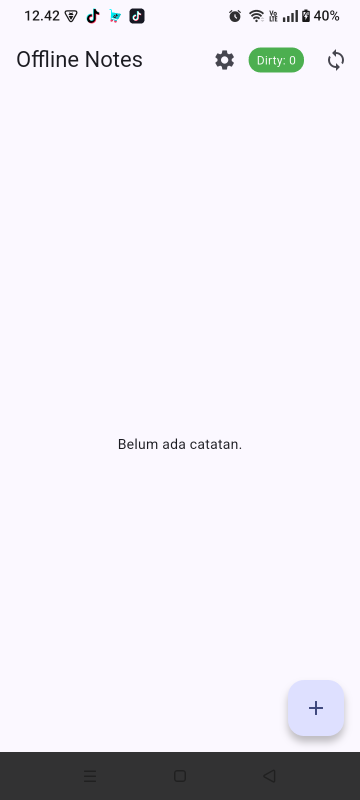
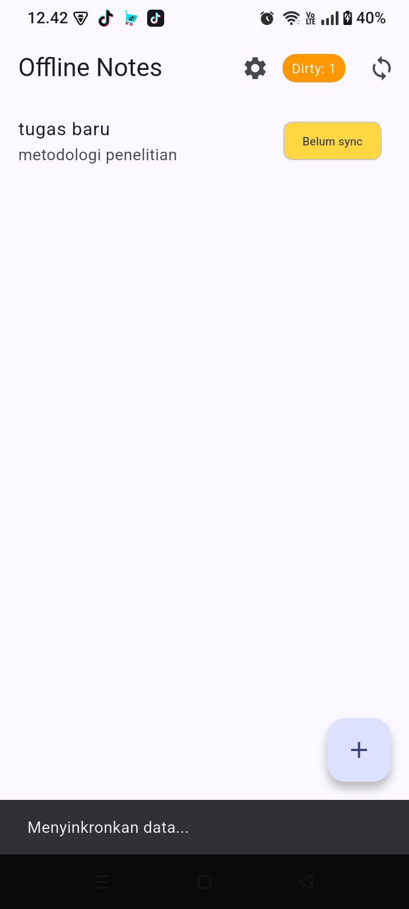
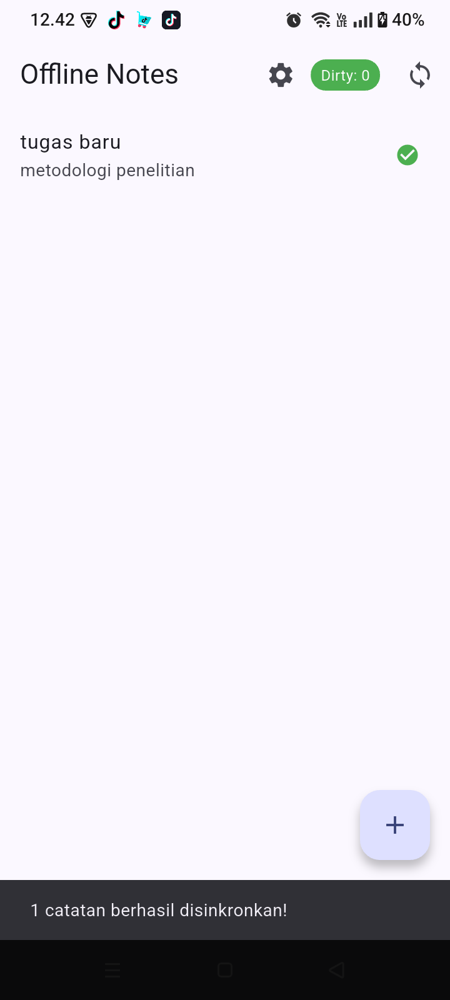
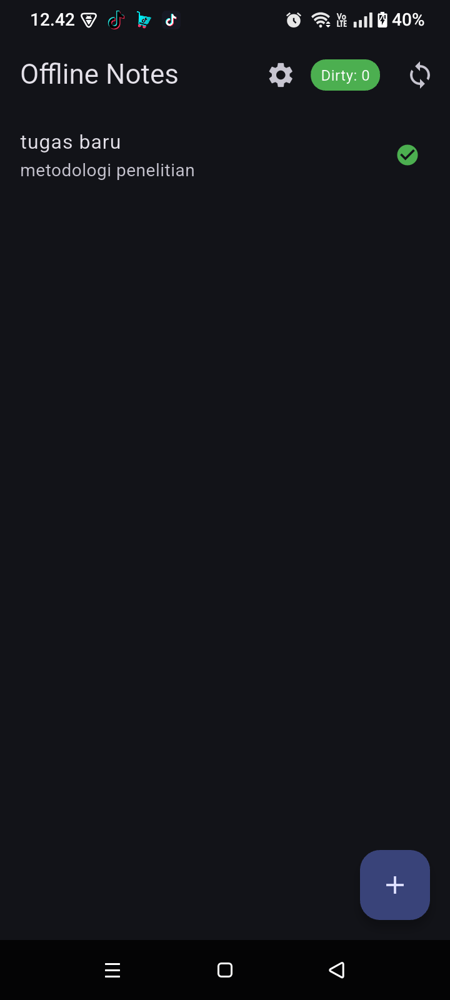
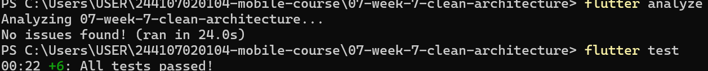

# Tugas Minggu 7: Clean Architecture & SOLID Principles

**Mata Kuliah:** Mobile Development  
**Aplikasi:** Offline Notes (Refactor dari project Minggu 5)  

Aplikasi ini merupakan hasil *refactoring* dari project manajemen catatan (*Offline Notes*) agar mematuhi aturan **SOLID** dan menerapkan struktur **Feature-First Clean Architecture**. Tujuan utama perombakan ini adalah untuk memisahkan lapisan UI (*Presentation*), logika bisnis (*Domain*), dan infrastruktur data (*Data*), tanpa mengubah fungsionalitas dan tampilan UI yang sudah ada.

---

## 1. Praktikum 1: Audit Layer Project Lama

Berikut adalah pemetaan file dari project sebelumnya (`week5_offline_notes`) beserta masalah arsitektur yang melanggar *Dependency Rule*:

| File | Layer saat ini | Masalah |
| :--- | :--- | :--- |
| `lib/main.dart` | `presentation` (root) | Menginstansiasi `PrefsRepository()` secara manual di dalam `main()` (DI bocor) dan belum memisahkan konfigurasi rute ke `routes.dart`. |
| `lib/pages/notes_page.dart` | `presentation` (+ state & DI) | Menginstansiasi `NoteRepository()` langsung di baris 9, mencampur deklarasi provider dengan widget UI, serta mengimpor `note.dart`, `note_repository.dart`, dan `sync.dart` langsung dari layer `data`. |
| `lib/pages/settings_page.dart` | `presentation` (+ state & DI) | Menginstansiasi `PrefsRepository()` langsung di baris 5, menyatukan `DarkModeNotifier` di dalam file halaman UI, dan menampilkan waktu `lastOpened` dalam format string ISO mentah. |
| `lib/pages/note_detail_page.dart` | `presentation` | Mengimpor model dan repository langsung dari layer `data` tanpa melewati kontrak layer `domain`. |
| `lib/widgets/note_tile.dart` | `presentation` | Mengimpor class `Note` langsung dari `data/local/note.dart` (melanggar *dependency rule*: `presentation` bergantung ke `data`). |
| `lib/data/local/db.dart` | `data` | OK bila hanya dipakai oleh implementasi repository (`openNotesDb`), bukan dipanggil langsung oleh widget. |
| `lib/data/local/note.dart` | `data` (+ entity tercampur) | Objek bisnis murni (*Entity*) masih tercampur dengan fungsi serialisasi SQLite (`toMap` dan `fromMap`) dalam satu class. |
| `lib/data/repositories/note_repository.dart` | `data` (+ kontrak tercampur) | Kontrak (*interface*) dan implementasi SQLite (`sqflite`) masih berada di satu class konkret, serta belum membungkus exception ke dalam `Failure`. |
| `lib/data/prefs.dart` | `data` (+ kontrak tercampur) | Kontrak dan implementasi `SharedPreferences` masih menyatu dalam satu class konkret (`PrefsRepository`). |
| `lib/data/sync.dart` | `data` (+ logika bisnis) | Operasi bisnis sinkronisasi (`syncNotes`) berada di layer `data` dan memanggil class repository konkret alih-alih menjadi *Use Case* di layer `domain`. |

### Hasil Pencarian Tiga Pelanggaran Klasik (Sebelum Refactor)
1. **Widget menyentuh jaringan / database langsung (`lib/pages`, `lib/widgets`):**
   * Hasil: `0 temuan` (Akses `sqflite` dan `SharedPreferences` sudah berada di dalam class repository).
2. **Logika bisnis / formatting di dalam `build()` (`lib/pages`, `lib/widgets`):**
   * Hasil: `0 temuan` eksplisit, namun string ISO-8601 dari `getLastOpened()` ditampilkan mentah di `settings_page.dart`.
3. **Instansiasi manual / Dependency Injection bocor (`lib/pages`, `lib/widgets`):**
   * Hasil: **2 temuan** (Deklarasi Provider yang langsung menginstansiasi repo secara manual `new Repository()` di file UI).

---

## 2. Struktur Baru: Feature-First Clean Architecture

Setelah di-refactor, proyek ini menggunakan arsitektur *feature-first* di mana aturan *Dependency Rule* dipatuhi dengan ketat (dependensi hanya mengarah ke dalam layer `domain`).

```text
lib/
├── core/
│   ├── failures.dart                        # Class pembungkus error (murni Dart)
│   └── format.dart                          # Fungsi pemformatan string tanggal
├── features/
│   └── notes/
│       ├── domain/
│       │   ├── entities/note.dart           # Objek bisnis murni
│       │   ├── repositories/note_repository.dart  # Interface kontrak (abstraksi)
│       │   └── usecases/                    # Logika bisnis
│       │       ├── add_note.dart
│       │       ├── get_notes.dart
│       │       └── sync_notes.dart
│       ├── data/
│       │   ├── models/note_model.dart       # Mapping JSON/SQLite (toMap, fromMap)
│       │   └── repositories/note_repository_impl.dart # Implementasi eksekusi SQLite
│       └── presentation/
│           ├── providers/notes_providers.dart # Riverpod DI & State
│           └── pages/notes_page.dart        # UI Bersih tanpa import layer Data
└── main.dart
```

---

## 3. Bukti Behavior Identik (Before vs After Refactor)

Berikut adalah perbandingan tampilan aplikasi sebelum di-refactor (Minggu 5) dan sesudah di-refactor (Minggu 7). Tampilan, fitur badge *Dirty*, dan *Dark Mode* tetap **100% identik**.

| Fitur / State | Sebelum Refactor (Minggu 5) | Sesudah Refactor (Minggu 7) |
| :--- | :--- | :--- |
| **Empty State**<br>*(Awal dibuka, belum ada data)* |  |  |
| **Data Kotor (Belum Sync)**<br>*(Tambah catatan offline)* |  |  |
| **Data Bersih (Sesudah Sync)**<br>*(Tombol sync ditekan)* |  |  |
| **Dark Mode**<br>*(Mengubah tema di pengaturan)* |  |  |

---

## 4. Verifikasi Clean Architecture & Unit Testing

Seluruh file telah diverifikasi menggunakan:
1. `grep` / `Select-String`: Layer `presentation` bersih dari `sqflite`/`Dio` dan layer `domain` bersih dari impor framework Flutter/infrastruktur.
2. `flutter analyze`: **No issues found!**
3. `flutter test`: Pengujian unit untuk layer `domain` menggunakan `FakeNoteRepository` berhasil memverifikasi alur *Use Case* tanpa memerlukan SQLite sungguhan.



---

## 5. Refleksi

* **Mengapa interface repository harus tinggal di domain, bukan di data? Apa yang rusak bila dibalik?**
  Prinsip *Dependency Inversion*. Layer `domain` berisi logika inti aplikasi yang tidak boleh bergantung pada teknologi spesifik (SQLite/API). Dengan meletakkan *interface* di `domain`, *Use Case* dapat bekerja menggunakan "kontrak" tanpa memedulikan implementasinya. Jika dibalik, `domain` akan bergantung pada `data`, sehingga unit test menjadi sulit dilakukan tanpa database sungguhan, dan mengganti basis data di masa depan akan merusak logika bisnis.

* **Kapan use case benar-benar dibutuhkan, dan kapan repository langsung ke notifier sudah cukup?**
  *Use Case* dibutuhkan ketika ada logika bisnis tambahan, seperti validasi input (`AddNote`), atau saat operasi memerlukan koordinasi beberapa fungsi sekaligus (`SyncNotes` yang harus mengecek jumlah kotor, melakukan penundaan simulasi, dan menandai bersih secara berurutan). Untuk operasi CRUD pasif 1-baris (misal: mengambil daftar catatan tanpa modifikasi), memanggil repository langsung dari *notifier* sudah cukup.

* **Apa biaya over-engineering (use case per CRUD satu-baris) bagi tim kecil? Kapan biayanya sepadan?**
  Bagi tim kecil, membuat Use Case terpisah untuk operasi ambil data sederhana (CRUD 1-baris) adalah *over-engineering* yang menghasilkan banyak file *boilerplate*. Ini memperlambat pengiriman fitur (delivery). Biaya ini baru menjadi sepadan pada aplikasi skala *Enterprise* yang besar di mana aturan bisnis sering berubah dan sangat kompleks, sehingga isolasi ketat antar-lapis mutlak diperlukan.

* **Bagian mana dari usulan AI yang Anda tolak atau sederhanakan, dan mengapa?**
  (Telah didokumentasikan di `docs/ai_challenge.md`). Saya **menyederhanakan/menolak** saran pembuatan *Use Case* secara membabi-buta untuk setiap aksi CRUD. Saya memilih pendekatan hibrida: menggunakan *Use Case* hanya untuk operasi `SyncNotes` dan `AddNote` (karena ada validasi), tetapi mengizinkan state *notifier* membaca langsung antarmuka repository untuk pengambilan data dasar demi menghindari kerumitan file yang tidak berguna.