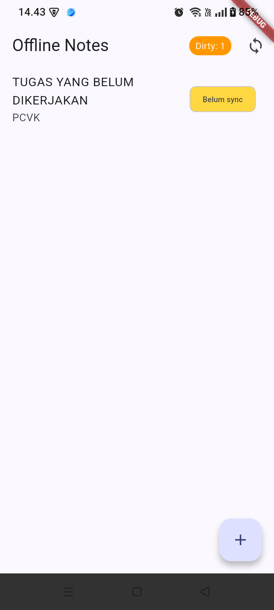
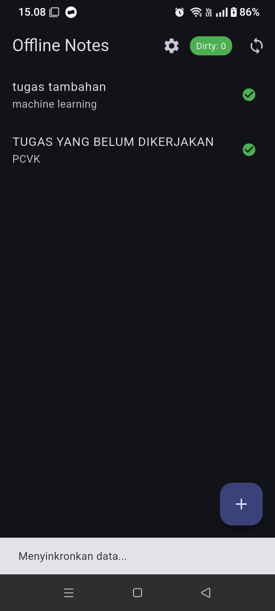

# Week 5: Local Storage & Offline-First Notes Application

Aplikasi catatan berbasis Flutter yang menerapkan arsitektur *offline-first*, penyimpanan lokal hibrida (SharedPreferences + SQLite), antrean sinkronisasi berbasis *dirty flag*, dan manajemen status reaktif menggunakan Riverpod.

---

## 1. Fitur Utama

- **Preferensi Lokal**: Pengaturan tema (gelap/terang) dan pencatatan waktu terakhir aplikasi dibuka berbasis *key-value* menggunakan SharedPreferences.
- **CRUD Catatan Persisten**: Manajemen data catatan tersimpan di SQLite lokal (`sqflite`), otomatis diurutkan berdasarkan `updated_at DESC`.
- **Offline-First & Dirty Tracking**: Operasi baca/tulis berfungsi penuh tanpa jaringan internet. Entri lokal yang belum dikirim ke server ditandai otomatis dengan `dirty = 1`.
- **Antrean Sinkronisasi**: Memicu sinkronisasi manual untuk mengunggah catatan tertunda dan mereset status `dirty` menjadi `0`.
- **Unit Testing**: Pengujian model serialisasi dan abstraksi provider menggunakan *fake repository* tanpa ketergantungan database fisik.

---

## 2. Stack Teknologi

- **Framework**: Flutter (Dart SDK 3.x)
- **State Management**: Flutter Riverpod (`Provider`, `FutureProvider`, `AsyncNotifierProvider`)
- **Key-Value Store**: `shared_preferences`
- **Relational Database**: `sqflite` & `path`
- **Testing**: `flutter_test`

---

## 3. Bukti Implementasi & Mode Pesawat

| Kondisi Awal (Kosong) | Sebelum Sinkronisasi (Offline/Dirty) | Sesudah Sinkronisasi (Synced) | Tampilan Final + Settings |
| :---: | :---: | :---: | :---: |
|  |  |  |  |

---

## 4. Aturan Resolusi Konflik (Conflict Resolution Rule)

Aplikasi menetapkan aturan **Last-Write-Wins (LWW)** berdasarkan stempel waktu kolom `updated_at`:
- Setiap perubahan pada entri lokal mencatat waktu `DateTime.now().toIso8601String()`.
- Saat proses sinkronisasi dua arah terjadi, data dengan nilai `updated_at` paling mutakhir yang akan dipertahankan di database pusat maupun cache lokal.
- Strategi ini mencegah data tertimpa secara implisit saat perangkat kembali online setelah sesi perubahan offline yang panjang.

---

## 5. Cara Menjalankan Proyek

1. Pasang dependensi:
   ```bash
   flutter pub get
